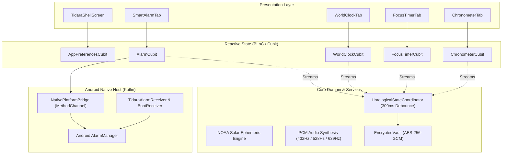

# Tidara Smartclock

[](https://github.com/NaveenSuresh07/tidara_smartclock/actions/workflows/ci.yml)
[](https://flutter.dev)
[](android/)
[](https://bloclibrary.dev)
[](test/)
[](LICENSE)

A modern Android clock application built with Flutter and Kotlin, featuring sunrise-aligned alarms, an interactive world clock with day/night visualization, a focus timer with animated sand physics, and a precision chronometer.

---

## Screenshots

| Alarms & Sunrise Arc | Celestial World Clock | Focus & Sand Timer | Precision Chronometer |
| :---: | :---: | :---: | :---: |
|  |  |  |  |

---

## Demo Video

🎬 **[Watch the Tidara App Demo Video](PASTE_DEMO_VIDEO_URL_HERE)** *(Google Drive / YouTube link)*

---

## Download APK

Pre-built release package for Android:

- 📦 **[Download tidara-v1.0.0-arm64.apk](https://github.com/NaveenSuresh07/tidara_smartclock/releases/tag/v1.0.0)** (17.54 MB)

> **Installation Note:** To sideload this APK on Android, enable **"Install unknown apps"** for your browser or file manager when prompted.

---

## Key Features

### 1. Smart Alarms & Solar Awakening
- **Sunrise Arc Dial:** Drag a bead along the solar arc to schedule alarms visually relative to natural dawn (e.g. *17m before sunrise*).
- **NOAA Solar Calculation:** Computes exact dawn, sunrise, solar noon, and sunset for any coordinate on Earth with polar latitude domain guards.
- **Optimal Sleep Window:** Calculates target bedtime based on healthy sleep duration targets (e.g. 7h 45m wind-down reminder).
- **Soothing Acoustic Awakening:** Built-in preview button and synthesized harmonic tones (432Hz, 528Hz, 639Hz) to avoid harsh, stressful alarm tones.
- **Native Android OS Integration:** Uses Kotlin `MethodChannel` with `AlarmManager.setExactAndAllowWhileIdle()`, `WakeLock`, and full-screen lockscreen wake intents (`FullScreenIntent`).
- **Reboot Persistence:** `TidaraBootReceiver` restores scheduled alarms after device restarts or timezone changes.

### 2. World Clock with Day & Night Projection
- **Armillary Globe Projection:** 3D orthographic projection of the globe with solar terminator curves showing live daylight and night regions.
- **14 Pre-Calibrated Cities:** Quick access to global metropolises with live time delta and local sunrise countdowns.
- **Resilient City Search:** Open-Meteo REST API integration with exponential backoff retries, backed by a 24-hour TTL disk cache for seamless offline use.

### 3. Focus Timer & Sculptural Hourglass
- **Procedural Sand Physics:** Canvas-rendered hourglass with falling sand particles and kinetic inversion.
- **Curated Focus Presets:** Built-in quick blocks for different work modes:
  - `12m` (Sprint)
  - `24m` (Focus Interval)
  - `25m` (Pomodoro)
  - `48m` (Double Interval)
  - `90m` (Deep Flow)
  - *Custom duration entry:* Supports any duration from 1 to 180 minutes.
- **Acoustic Soundscapes:** Zero-dependency, on-device 16-bit PCM RIFF WAVE synthesis for solfeggio focus tones.

### 4. Precision Chronometer
- **Monotonic Clock:** Tracks elapsed microsecond deltas independent of UI frame rates.
- **Isolated RepaintBoundaries:** Smooth 60 FPS sweep hand and dial needle animations.
- **Lap Telemetry:** Dynamic split and lap table automatically highlighting fastest (green) and slowest (amber) laps.
- **Haptic & Audio Ticks:** Synthesized mechanical escapement clicks on start, lap, and split.

### 5. Design System & Accessibility
- **Dual-Mode Liquid Glass UI:** Translucent glass cards and buttons in Warm Light (`#F4F0E8`) and Deep Dark (`#14110F`) palettes.
- **WCAG 2.1 AA Compliance:** Every foreground/background pair meets >= 4.5:1 contrast (>= 3:1 for large accent elements).
- **High-Contrast Mode Setting:** Optional toggle for users who need maximum contrast without translucency.
- **Plain-Language Setting:** Toggle that simplifies all labels into everyday English.

---

## UX Decisions

*These design choices reflect my goals for the app's user experience:*

1. **Alarms tied to sunrise and the optimal sleep window:** Standard alarms focus solely on waking up at an arbitrary number, ignoring natural circadian rhythms. I tied the alarm scrubber to local sunrise and added the optimal sleep window card so users can visually align their sleep cycle with natural daylight and plan an adequate wind-down schedule.
2. **High-contrast mode and WCAG 2.1 AA standards:** While liquid glass aesthetics look modern, legibility is non-negotiable. I ensured all text and icon pairs meet strict 4.5:1 contrast across both light and dark themes, and added a dedicated High-Contrast toggle for users who need crisp visual clarity without subtle transparency.
3. **Plain-language labels as a first-class setting:** Not everyone wants astronomical or esoteric terms when setting an alarm. I created a plain-language setting that simplifies labels across all screens (e.g. changing "Dawn Rhythm" to "Alarm" and "Solar Focus" to "Focus Session") so users can choose between poetic and everyday terminology.
4. **Armillary globe with live day and night display:** A flat list of city names and GMT numbers does not give users an intuitive feel for global time. The 3D globe with solar terminator curves lets users immediately see whether a colleague or family member across the world is in daylight, twilight, or the middle of the night.
5. **Hourglass visualization and curated focus intervals:** Standard digital countdown clocks induce time anxiety. The tactile sand animation offers a calming visual sense of time elapsing. I selected presets for 12m (quick sprint), 24m (traditional focus block), 25m (Pomodoro), 48m (double session), and 90m (deep ultradian rhythm) to cover how people actually study and work.
6. **Gentle "Solar Awakening" preview and harmonic tones:** Jarring smartphone alarms trigger an immediate morning stress spike. I synthesized harmonic solfeggio frequencies (432Hz, 528Hz, 639Hz) directly in code and added a quick "Preview Tone" chip so users can audition sounds at comfortable volumes and wake up peacefully.
7. **What I would improve next:** The app is currently Android-only because exact background alarms and wake locks rely on native Kotlin platform services. My next milestone is writing the native iOS counterpart using the `UserNotifications` framework and iOS Live Activities for timer tracking.

---

## How I Built This

I designed Tidara Smartclock as part of a UX-focused mobile challenge ("Design a Clock Application"). I used AI coding tools for parts of development (scaffolding, ephemeris mathematical modeling, and test suites), while directing all product design, UX decisions, color palettes, architectural boundaries, and native Android platform integration myself.

---

## Architecture

Tidara follows **Feature-First Clean Architecture** with unidirectional state management using **BLoC/Cubit**:



- **Persistence Coalescing:** The `HorologicalStateCoordinator` subscribes to all feature cubits and buffers state updates with a 300ms debounce, eliminating redundant flash storage writes.
- **Authenticated Storage:** Application state is encrypted at rest using AES-256-GCM with unique 96-bit CSPRNG nonces per write, backed by the hardware Android Keystore via `flutter_secure_storage`.
- **Power Optimization:** Observes `AppLifecycleState` via `WidgetsBindingObserver` to halt 1Hz tickers when the app is paused, eliminating idle battery drain.

---

## Platform Support

- **Supported Platform:** **Android Only** (API 24+ / Android 7.0+, recommended API 34+).
- **Reason:** Reliable background alarms and wake-from-sleep features require low-level integration with the Android OS (`AlarmManager.setExactAndAllowWhileIdle`, `WakeLock`, and lockscreen `FullScreenIntent`). Unused default desktop and iOS templates have been removed from the repository to keep the codebase clean.

---

## Automated Testing & Verification

The codebase is protected by **232 automated Dart tests** and **4 native Kotlin JVM tests**:

```bash
# 1. Code Formatting (0 changed files)
dart format --output=none --set-exit-if-changed .

# 2. Static Analysis (0 warnings, 0 infos)
flutter analyze --fatal-infos --fatal-warnings

# 3. Flutter Automated Test Suite (232 passed, 0 failed)
flutter test

# 4. Native Kotlin JVM Tests (4 passed, 0 failed)
cd android
./gradlew :app:testDebugUnitTest
cd ..
```

---

## Limitations

- **Android Only:** iOS and desktop builds are not supported due to native background service dependencies.
- **Exact Alarm Permissions:** On Android 12+ (API 31+), exact alarms require the `SCHEDULE_EXACT_ALARM` or `USE_EXACT_ALARM` permission. The app displays an in-app banner if permission is revoked.
- **OEM Battery Restrictions:** Aggressive battery management profiles (e.g. Xiaomi MIUI, OnePlus OxygenOS, Samsung One UI) can delay background alarms unless battery optimization is set to "Unrestricted" for the app.
- **Tested Devices:** Verified on physical Android hardware (Android 14 / API 34) and standard Android emulators.

---

## How to Run

### Prerequisites
- **Flutter SDK:** 3.32.3 (Dart 3.8.1)
- **Android SDK:** API 34+
- **JDK:** Java 17

### Setup Steps
```bash
# 1. Clone the repository
git clone https://github.com/NaveenSuresh07/tidara_smartclock.git
cd tidara_smartclock

# 2. Install dependencies
flutter pub get

# 3. Run on connected Android device
flutter run
```

---

## License

This project is licensed under the MIT License - see the [LICENSE](LICENSE) file for details.
