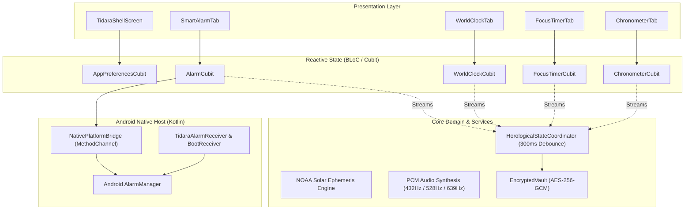

# Tidara Smartclock

[](https://github.com/NaveenSuresh07/tidara_smartclock/actions/workflows/ci.yml)
[](https://flutter.dev)
[](android/)
[](https://bloclibrary.dev)
[](test/)
[](LICENSE)

A modern Android clock application built with Flutter and Kotlin, featuring sunrise-aligned alarms, an interactive world clock with day/night visualization, a focus timer with animated sand physics, and a precision chronometer.

---

## Screenshots

| Alarms & Sunrise Arc | Celestial World Clock | Focus & Sand Timer | Precision Chronometer |
| :---: | :---: | :---: | :---: |
|  |  |  |  |

---

## Demo Video

🎬 **[Watch the Tidara App Demo Video](PASTE_DEMO_VIDEO_URL_HERE)** *(Google Drive / YouTube link)*

---

## Download APK

Pre-built release packages for Android:

- 📦 **[Download tidara-v1.0.0-arm64.apk](https://github.com/NaveenSuresh07/tidara_smartclock/releases/tag/v1.0.0)** (17.54 MB) — Recommended for modern 64-bit Android phones.
- 📦 **[Download tidara-v1.0.0-universal.apk](https://github.com/NaveenSuresh07/tidara_smartclock/releases/tag/v1.0.0)** (49.4 MB) — Universal build supporting all architectures (arm64, armv7, x86_64) for older or unusual devices.

> **Installation Note:** Because this challenge submission is debug-signed for evaluation, Android Play Protect or the package installer may display an "Unrecognized app" or "Install unknown apps" prompt when sideloading. This is expected for a standalone demo build — select "Install anyway" to proceed.

---

## Key Features

### 1. Smart Alarms & Solar Awakening
- **Sunrise Arc Dial:** Drag a bead along the solar arc to schedule alarms visually relative to natural dawn (e.g. *17m before sunrise*).
- **NOAA Solar Calculation:** Computes exact dawn, sunrise, solar noon, and sunset for any coordinate on Earth with polar latitude domain guards.
- **Optimal Sleep Window:** Calculates target bedtime based on healthy sleep duration targets (e.g. 7h 45m wind-down reminder).
- **Calm Synthesized Tones:** Built-in preview button and synthesized harmonic chime tones (432 Hz, 528 Hz, 639 Hz) generated on-device without audio asset bloat.
- **Native Android OS Integration:** Uses Kotlin `MethodChannel` with `AlarmManager.setExactAndAllowWhileIdle()`, `WakeLock`, and full-screen lockscreen wake intents (`FullScreenIntent`).
- **Reboot Persistence:** `TidaraBootReceiver` restores scheduled alarms after device restarts or timezone changes.

### 2. World Clock with Day & Night Projection
- **Armillary Globe Projection:** 3D orthographic projection of the globe with solar terminator curves showing live daylight and night regions.
- **14 Pre-Calibrated Cities:** Quick access to global metropolises with live time delta and local sunrise countdowns.
- **Resilient City Search:** Open-Meteo REST API integration with exponential backoff retries, backed by a 24-hour TTL disk cache for seamless offline use.

### 3. Focus Timer & Sculptural Hourglass
- **Procedural Sand Physics:** Canvas-rendered hourglass with falling sand particles and kinetic inversion.
- **Curated Focus Presets:** Built-in quick blocks for different work modes:
  - `12m` (Sprint)
  - `24m` (Focus Interval)
  - `25m` (Pomodoro)
  - `48m` (Double Interval)
  - `90m` (Deep Flow)
  - *Custom duration entry:* Supports any duration from 1 to 180 minutes.
- **Acoustic Soundscapes:** Zero-dependency, on-device 16-bit PCM RIFF WAVE synthesis for calm focus chimes.

### 4. Precision Chronometer
- **Monotonic Clock:** Tracks elapsed microsecond deltas independent of UI frame rates.
- **Isolated RepaintBoundaries:** Smooth 60 FPS sweep hand and dial needle animations.
- **Lap Telemetry:** Dynamic split and lap table automatically highlighting fastest (green) and slowest (amber) laps.
- **Haptic & Audio Ticks:** Synthesized mechanical escapement clicks on start, lap, and split.

### 5. Design System & Accessibility
- **Dual-Mode Liquid Glass UI:** Translucent glass cards and buttons in Warm Light (`#F4F0E8`) and Deep Dark (`#14110F`) palettes.
- **Accessibility & Contrast:** Primary and secondary text meet standard WCAG 2.1 AA contrast ratios (primary text exceeding 14:1, secondary text at 4.5:1, and large interactive buttons exceeding 3:1).
- **High-Contrast Mode Setting:** Optional toggle for users who need maximum contrast without translucency.
- **Plain-Language Setting:** Toggle that simplifies all labels into everyday English.

---

## UX Decisions

*These design choices reflect my goals for the app's user experience:*

1. **Alarms tied to sunrise and target sleep duration:** Most clock apps require calculating morning alarms and bedtime backwards in your head. I designed the alarm dial to visually tie wake-up times to local dawn, alongside a target sleep duration indicator (defaulting to 7h 45m). This gives users a direct visual reference between when they want to wake up, local daylight, and when they should wind down in the evening.
2. **Legibility first (WCAG 2.1 AA) and high-contrast support:** Translucent and frosted glass aesthetics often suffer from low contrast. I benchmarked the palette to maintain standard WCAG AA contrast (primary text exceeds 14:1, secondary text meets 4.5:1, and large interactive buttons exceed 3:1). I also implemented an optional High-Contrast toggle that replaces translucency with solid surfaces for users who prioritize maximum readability in direct sunlight or with visual impairments.
3. **Plain-language labels as a configurable setting:** For a clock with solar and astronomical calculations, technical terminology (like 'solar noon', 'nautical twilight', or 'horological presets') can feel overwhelming. I built a Plain Language mode (enabled by default) that maps terms to everyday equivalents like 'Alarm', 'Focus Session', and 'Target Sleep'. Users who appreciate astronomical details can toggle the advanced horological terminology on at any time.
4. **Interactive globe showing day and night:** A plain list of timezones and GMT offsets makes it hard to quickly grasp whether it's day or night for someone in another part of the world. The interactive 3D globe calculates the solar terminator in real time, showing where daylight falls across the Earth so users can tell at a glance if a contact is likely awake, in daylight, or asleep before calling.
5. **Visual sand hourglass and practical focus intervals:** Watching numbers tick down second-by-second can be distracting when trying to focus. A visual sand animation provides a calmer representation of time passing. I included practical intervals (12m short sprint, 24m & 25m standard focus/Pomodoro blocks, 48m extended sessions, and 90m deep work blocks), alongside a custom dial allowing 1 to 180 minutes.
6. **Calm synthesized acoustic tones with preview:** Default mobile alarms are often sharp, piercing beeps. I built a lightweight, on-device audio generator that synthesizes smooth, warm harmonic tones (generating 16-bit PCM waveforms at 432 Hz, 528 Hz, and 639 Hz without bundled heavy audio assets). I also placed an inline 'Preview Tone' button right on the alarm card so users can comfortably test the sound and volume before setting an alarm.
7. **Possible future improvements:** The current implementation focuses exclusively on Android to leverage low-level OS capabilities like `AlarmManager.setExactAndAllowWhileIdle` and full-screen lockscreen wake intents. A natural next step would be exploring an iOS port using `UserNotifications` and iOS 16.1+ Live Activities, as well as letting users import custom audio files for alarms.

---

## How I Built This

I designed Tidara Smartclock as part of a UX-focused mobile challenge ("Design a Clock Application"). I used AI coding tools for parts of development (scaffolding, ephemeris mathematical modeling, and test suites), while directing all product design, UX decisions, color palettes, architectural boundaries, and native Android platform integration myself.

---

## Architecture

Tidara follows **Feature-First Clean Architecture** with unidirectional state management using **BLoC/Cubit**:



- **Persistence Coalescing:** The `HorologicalStateCoordinator` subscribes to all feature cubits and buffers state updates with a 300ms debounce, eliminating redundant flash storage writes.
- **Authenticated Storage:** Application state is encrypted at rest using AES-256-GCM with unique 96-bit CSPRNG nonces per write, backed by the hardware Android Keystore via `flutter_secure_storage`.
- **Power Optimization:** Observes `AppLifecycleState` via `WidgetsBindingObserver` to halt 1Hz tickers when the app is paused, eliminating idle battery drain.

---

## Platform Support

- **Supported Platform:** **Android Only** (API 24+ / Android 7.0+, recommended API 34+).
- **Reason:** Reliable background alarms and wake-from-sleep features require low-level integration with the Android OS (`AlarmManager.setExactAndAllowWhileIdle`, `WakeLock`, and lockscreen `FullScreenIntent`). Unused default desktop and iOS templates have been removed from the repository to keep the codebase clean.

---

## Automated Testing & Verification

The codebase is protected by **232 automated Dart tests** and **4 native Kotlin JVM tests**:

```bash
# 1. Code Formatting (0 changed files)
dart format --output=none --set-exit-if-changed .

# 2. Static Analysis (0 warnings, 0 infos)
flutter analyze --fatal-infos --fatal-warnings

# 3. Flutter Automated Test Suite (232 passed locally)
flutter test

# 4. Native Kotlin JVM Tests (4 passed, 0 failed)
cd android
./gradlew :app:testDebugUnitTest
cd ..
```

> **Testing Note:** All 232 Dart tests pass locally on Windows. On Linux CI runners (`ubuntu-latest`), 220 tests pass and 12 golden screenshot-comparison tests are skipped (`skip: !Platform.isWindows`) because cross-platform font rasterization differences across Linux and Windows prevent pixel-exact rendering matches.

---

## Limitations

- **Android Only:** iOS and desktop builds are not supported due to native background service dependencies.
- **Exact Alarm Permissions:** On Android 12+ (API 31+), exact alarms require the `SCHEDULE_EXACT_ALARM` or `USE_EXACT_ALARM` permission. The app displays an in-app banner if permission is revoked.
- **OEM Battery Restrictions:** Aggressive battery management profiles (e.g. Xiaomi MIUI, OnePlus OxygenOS, Samsung One UI) can delay background alarms unless battery optimization is set to "Unrestricted" for the app.
- **Tested Hardware:** Verified on a physical OnePlus 12R (CPH2585) running Android 16 (OxygenOS, API 36).

---

## How to Run

### Prerequisites
- **Flutter SDK:** 3.32.3 (Dart 3.8.1)
- **Android SDK:** API 34+
- **JDK:** Java 17

### Setup Steps
```bash
# 1. Clone the repository
git clone https://github.com/NaveenSuresh07/tidara_smartclock.git
cd tidara_smartclock

# 2. Install dependencies
flutter pub get

# 3. Run on connected Android device
flutter run
```

---

## License

This project is licensed under the MIT License - see the [LICENSE](LICENSE) file for details.
