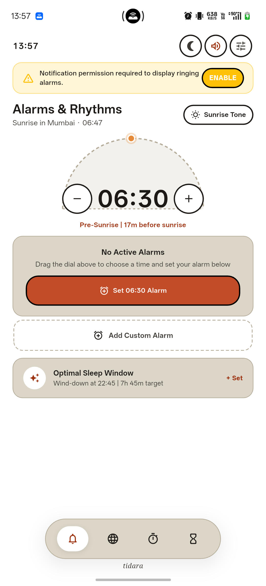
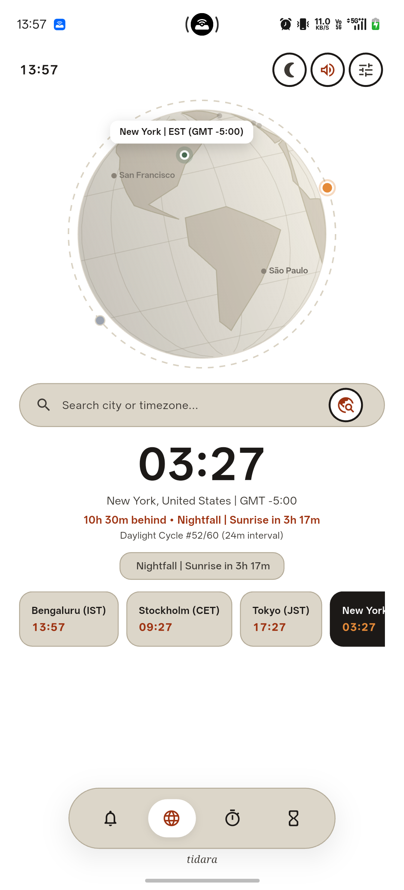
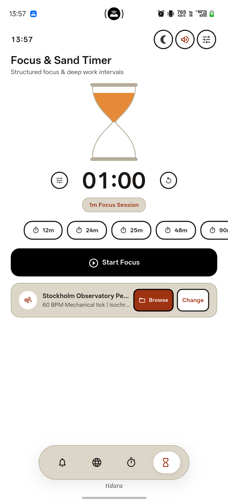
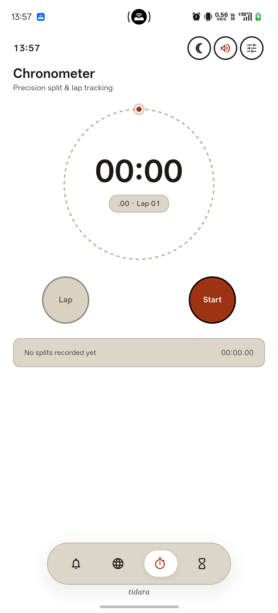

# Tidara Smartclock

[](https://github.com/NaveenSuresh07/tidara_smartclock/actions/workflows/ci.yml)
[](https://flutter.dev)
[](android/)
[](https://bloclibrary.dev)
[](test/)
[](LICENSE)

An Android clock app built with Flutter and Kotlin, featuring sunrise-based alarms, a 3D world clock with day/night projection, a focus hourglass timer, and a stopwatch.

🌐 **Landing page:** [https://naveensuresh07.github.io/tidara_smartclock/](https://naveensuresh07.github.io/tidara_smartclock/)

---

## Screenshots

| Alarms & Sunrise Arc | World Clock | Focus & Sand Timer | Precision Chronometer |
| :---: | :---: | :---: | :---: |
|  |  |  |  |

---

## Demo Video

🎬 **[Watch the Tidara App Demo Video (MP4, 2.96 MB)](https://naveensuresh07.github.io/tidara_smartclock/demo.mp4)** · [Direct download from GitHub Releases](https://github.com/NaveenSuresh07/tidara_smartclock/releases/download/v1.0.1/tidara-v1.0.1-demo.mp4)

---

## Download APK

Pre-built release packages for Android ([GitHub Release v1.0.1](https://github.com/NaveenSuresh07/tidara_smartclock/releases/tag/v1.0.1)):

- 📦 **[Download tidara-v1.0.1-arm64.apk](https://github.com/NaveenSuresh07/tidara_smartclock/releases/download/v1.0.1/tidara-v1.0.1-arm64.apk)** (17.54 MB) — Recommended for modern 64-bit Android phones.
- 📦 **[Download tidara-v1.0.1-universal.apk](https://github.com/NaveenSuresh07/tidara_smartclock/releases/download/v1.0.1/tidara-v1.0.1-universal.apk)** (49.4 MB) — Universal build supporting all architectures (arm64, armv7, x86_64) for older or unusual devices.

> **Installation Note:** Signed with a personal key and not distributed through Google Play, so Android may show an unknown-app warning when you sideload it. Choose 'Install anyway' to continue.

Scan to open the mobile download page:


---

## Key Features

### 1. Smart Alarms & Solar Awakening
- **Sunrise Arc Dial:** Drag a bead along the solar arc to schedule alarms visually relative to natural dawn (e.g. *17m before sunrise*).
- **NOAA Solar Calculation:** Computes exact dawn, sunrise, solar noon, and sunset for any coordinate on Earth with polar latitude domain guards.
- **Optimal Sleep Window:** Calculates target bedtime based on healthy sleep duration targets (e.g. 7h 45m wind-down reminder).
- **Calm Synthesized Tones:** Built-in preview button and synthesized harmonic chime tones (432 Hz, 528 Hz, 639 Hz) generated on-device without audio asset bloat.
- **Native Android OS Integration:** Uses Kotlin `MethodChannel` with `AlarmManager.setExactAndAllowWhileIdle()`, `WakeLock`, and full-screen lockscreen wake intents (`FullScreenIntent`).
- **Reboot Persistence:** `TidaraBootReceiver` restores scheduled alarms after device restarts or timezone changes.

### 2. World Clock with Day & Night Projection
- **3D Globe:** 3D orthographic projection of the globe with solar terminator curves showing live daylight and night regions.
- **16 Built-in Cities:** Quick access to global cities with live time delta and local sunrise countdowns.
- **Resilient City Search:** Open-Meteo REST API integration with exponential backoff retries, backed by a 24-hour TTL disk cache for seamless offline use.

### 3. Focus & Hourglass Timer
- **Procedural Sand Physics:** Canvas-rendered hourglass with falling sand particles and kinetic inversion.
- **Curated Focus Presets:** Built-in quick blocks for different work modes:
  - `12m` (Sprint)
  - `24m` (Focus Interval)
  - `25m` (Pomodoro)
  - `48m` (Double Interval)
  - `90m` (Deep Flow)
  - *Custom duration entry:* Supports any duration from 1 to 180 minutes.
- **Sound Tones:** On-device 16-bit PCM RIFF WAVE synthesis for calm focus chimes.

### 4. Precision Chronometer
- **Monotonic Clock:** Uses Dart's monotonic `Stopwatch` for millisecond-level timing (displayed to 0.01s precision) independent of UI frame rates.
- **Isolated RepaintBoundaries:** Uses `RepaintBoundary` isolation designed for smooth sweep hand and dial needle animations.
- **Lap Telemetry:** Dynamic split and lap table automatically highlighting fastest (green) and slowest (amber) laps.
- **Haptic & Audio Ticks:** Synthesized escapement click audio and haptic feedback on start, stop, reset, and lap.

### 5. Design System & Accessibility
- **Dual-Mode Liquid Glass UI:** Translucent glass cards and buttons in Warm Light (`#F4F0E8`) and Deep Dark (`#14110F`) palettes.
- **Accessibility & Contrast:** Primary and secondary text meet standard WCAG 2.1 AA contrast ratios (primary text exceeding 14:1, secondary text at 4.5:1, and large interactive buttons exceeding 3:1).
- **High-Contrast Mode:** Toggle in Settings (and automatic Android system high-contrast detection) that disables backdrop blur, gradients, and shadows across all four tabs, modals, and bottom sheets—switching to solid opaque fills, 1.5–2px borders, `#FFFFFF` / `#0C0A09` base backgrounds, and higher-contrast secondary text and accents.

---

## UX Decisions

*These design choices reflect my goals for the app's user experience:*

1. **Alarms tied to sunrise and target sleep duration:** Most clock apps require calculating morning alarms and bedtime backwards in your head. I designed the alarm dial to visually tie wake-up times to local dawn, alongside a target sleep duration indicator (defaulting to 7h 45m). This gives users a direct visual reference between when they want to wake up, local daylight, and when they should wind down in the evening.
2. **Legibility first (WCAG 2.1 AA) and high-contrast support:** Translucent surfaces can hurt readability if contrast isn't enforced. I benchmarked the default palette to keep primary text above 14:1, secondary text at 4.5:1, and large interactive controls above 3:1. Turning on High-Contrast Mode in Settings (or via Android's system accessibility setting) disables backdrop blur, gradients, and drop shadows across every tab and bottom sheet, switching to solid opaque surfaces, 1.5–2px solid borders, `#FFFFFF` / `#0C0A09` backgrounds, and higher-contrast secondary text and accent colors.
3. **Interactive globe showing day and night:** A plain list of timezones and GMT offsets makes it hard to quickly grasp whether it's day or night for someone in another part of the world. The interactive 3D globe calculates the solar terminator in real time, showing where daylight falls across the Earth so users can tell at a glance if a contact is likely awake, in daylight, or asleep before calling.
4. **Visual sand hourglass and practical focus intervals:** Watching numbers tick down second-by-second can be distracting when trying to focus. A visual sand animation provides a calmer representation of time passing. I included practical intervals (12m short sprint, 24m & 25m standard focus/Pomodoro blocks, 48m extended sessions, and 90m deep work blocks), alongside a custom dial allowing 1 to 180 minutes.
5. **Calm synthesized tones with preview:** Default mobile alarms are often sharp, piercing beeps. I built a lightweight, on-device audio generator that synthesizes smooth, warm harmonic tones (generating 16-bit PCM waveforms at 432 Hz, 528 Hz, and 639 Hz without bundled heavy audio assets). I also placed a "Sunrise Tone" preview button at the top of the Alarms screen so users can comfortably test the sound and volume before setting an alarm.
6. **Possible future improvements:** The current implementation focuses exclusively on Android to leverage low-level OS capabilities like `AlarmManager.setExactAndAllowWhileIdle` and full-screen lockscreen wake intents. A natural next step would be exploring an iOS port using `UserNotifications` and iOS 16.1+ Live Activities, as well as letting users import custom audio files for alarms.

---

## How I Built This

I designed Tidara Smartclock as part of a UX-focused mobile challenge ("Design a Clock Application"). I used AI tools for parts of development, and I reviewed, tested and directed the design decisions.

---

## Architecture

Tidara follows **Feature-First Clean Architecture** with unidirectional state management using **BLoC/Cubit**:


- **Persistence Coalescing:** The state coordinator (`lib/core/services/state_coordinator.dart`) subscribes to all feature cubits and buffers state updates with a 300ms debounce, reducing redundant flash storage writes.
- **Authenticated Storage:** Application state is encrypted at rest using AES-256-GCM with unique 96-bit CSPRNG nonces per write, backed by the Android Keystore via `flutter_secure_storage`.
- **Power Optimization:** Observes `AppLifecycleState` via `WidgetsBindingObserver` to halt 1Hz tickers when the app is paused, reducing idle battery drain.

---

## Platform Support

- **Supported Platform:** **Android Only** (`minSdk = 24` / Android 7.0+, `compileSdk = 36`).
- **Reason:** Reliable background alarms and wake-from-sleep features require low-level integration with the Android OS (`AlarmManager.setExactAndAllowWhileIdle`, `WakeLock`, and lockscreen `FullScreenIntent`). Unused default desktop and iOS templates have been removed from the repository to keep the codebase clean.

---

## Automated Testing & Verification

The codebase is protected by **232 automated Dart tests** and **4 native Kotlin JVM tests**:

```bash
# 1. Code Formatting (0 changed files)
dart format --output=none --set-exit-if-changed .

# 2. Static Analysis (0 warnings, 0 infos)
flutter analyze --fatal-infos --fatal-warnings

# 3. Flutter Automated Test Suite (232 passed locally)
flutter test

# 4. Native Kotlin JVM Tests (4 passed, 0 failed)
cd android
./gradlew :app:testDebugUnitTest
cd ..
```

> **Testing Note:** All 232 Dart tests pass locally on Windows. On Linux CI runners (`ubuntu-latest`), 220 tests pass and 12 golden screenshot-comparison tests are skipped (`skip: !Platform.isWindows`) because cross-platform font rasterization differences across Linux and Windows prevent pixel-exact rendering matches.

---

## Limitations

- **Android Only:** iOS and desktop builds are not supported due to native background service dependencies.
- **Exact Alarm Permissions:** On Android 12+ (API 31+), exact alarms require the `SCHEDULE_EXACT_ALARM` or `USE_EXACT_ALARM` permission. The app displays an in-app banner if permission is revoked.
- **OEM Battery Restrictions:** Aggressive battery management profiles (e.g. Xiaomi MIUI, OnePlus OxygenOS, Samsung One UI) can delay background alarms unless battery optimization is set to "Unrestricted" for the app.
- **Tested Device:** Verified on a physical OnePlus 12R (CPH2585) running Android 16 (OxygenOS, API 36).

---

## How to Run

### Prerequisites
- **Flutter SDK:** 3.32.3 (Dart 3.8.1)
- **Android SDK:** API 36 (`compileSdk = 36`; supports devices on `minSdk = 24`+)
- **JDK:** Java 17

### Setup Steps
```bash
# 1. Clone the repository
git clone https://github.com/NaveenSuresh07/tidara_smartclock.git
cd tidara_smartclock

# 2. Install dependencies
flutter pub get

# 3. Run on connected Android device
flutter run
```

---

## License

This project is licensed under the MIT License - see the [LICENSE](LICENSE) file for details.
