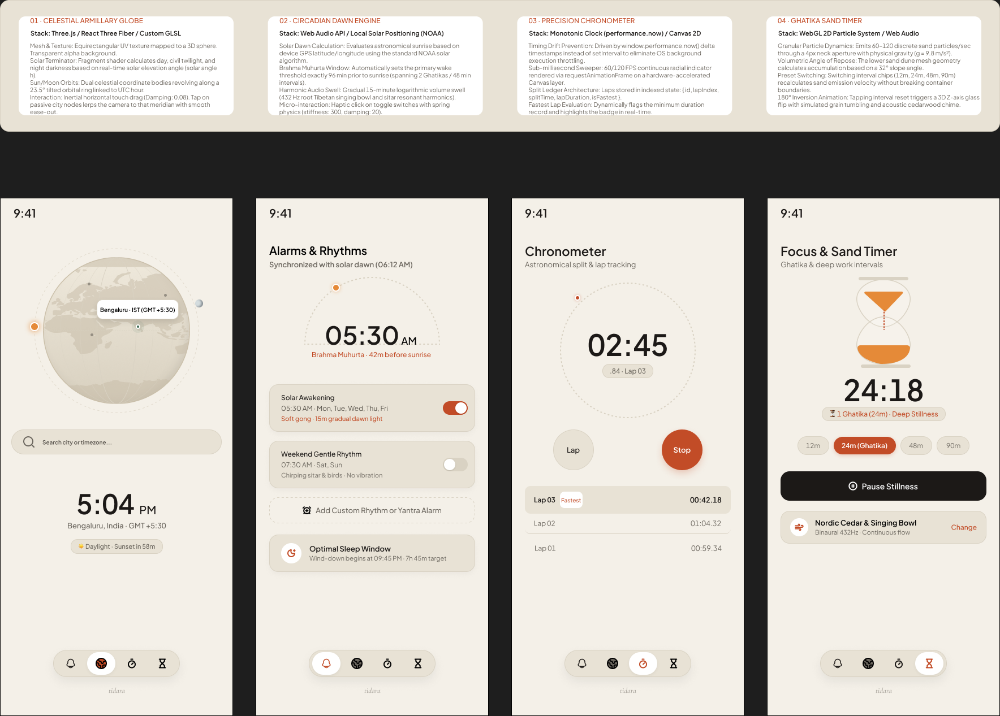
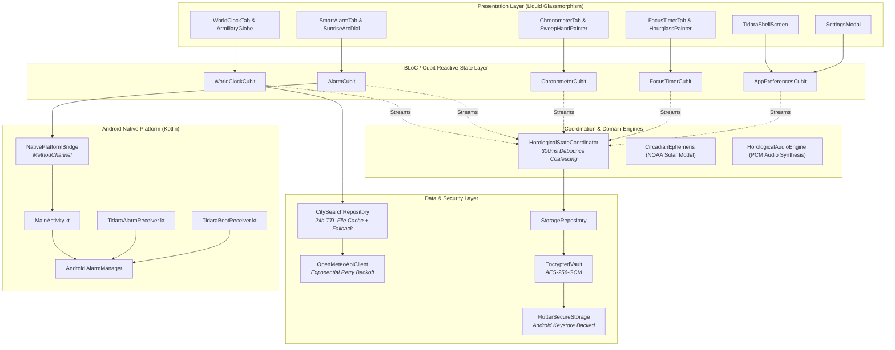

# Tidara Smartclock

[](https://flutter.dev)
[](https://bloclibrary.dev)
[](https://csrc.nist.gov/publications/detail/sp/800-38d/final)
[](test/)
[](LICENSE)

> **Tidara Smartclock** is an artisanal horological mobile application engineered with Flutter, Kotlin, and modern reactive architecture (BLoC/Cubit). It bridges astronomical and circadian science (NOAA solar ephemeris, harmonic sound synthesis) with high-fidelity tactile UI and production-grade mobile engineering — featuring authenticated AES-256-GCM encryption, Android Keystore-backed key persistence, native exact alarm scheduling, offline-resilient REST networking with TTL disk caching, and a liquid glassmorphic design system.

---

## Preview



---

## Architectural Highlights & Engineering Decisions

### 1. Feature-First Clean Architecture
The codebase is structured into modular feature slices (`features/world_clock`, `features/smart_alarm`, `features/chronometer`, `features/focus_timer`, `features/shell`). Each slice encapsulates its presentation layer, Cubit state management, and specialized widgets, completely decoupled from infrastructure details.



### 2. State Persistence & Debounced Coalescing
Rather than writing to disk on every high-frequency UI action, a centralized `HorologicalStateCoordinator` subscribes to state emissions from all feature cubits. It aggregates updates and applies a 300ms debounce buffer, serializing state into a unified atomic envelope and drastically reducing flash storage wear.

### 3. Cryptographic Security & Keystore Integration
Application state is secured at rest via an authenticated AES-256-GCM cipher envelope:
- **Authenticated Encryption:** 128-bit GCM authentication tags prevent tampering; any altered bitstream triggers deterministic decryption failure.
- **Nonce Freshness:** Cryptographically secure 96-bit random nonces generated per write prevent replay attacks and ciphertext predictability.
- **Hardware-Backed Key Store:** Master encryption keys are stored in `FlutterSecureStorage` using the Android Keystore system.
- **Atomic Key Rotation:** `rotateMasterKey()` re-encrypts the state in an isolated staging step. If an I/O or platform error occurs, previous state envelopes and keys remain intact.

---

## Core Features & Capabilities

### Multi-Zone Celestial World Clock
- **Solar Terminator & Day/Night Curves:** Canvas-rendered 3D orthographic projection depicting celestial coordinates, solar terminator lines, and day/night transitions across global metropolises.
- **Resilient Geocoding & Weather Integration:** Queries Open-Meteo REST APIs for live coordinates, timezone offsets, and weather conditions.
- **Fault-Tolerant Networking:** Implements automatic retries with exponential backoff on network failures, backed by a 24-hour disk cache and bundled offline reference cities.

### Solar Awakening Smart Alarm
- **NOAA Solar Ephemeris Engine:** Mathematical implementation of the NOAA solar position algorithm, calculating precise local dawn, sunrise, solar noon, and sunset for any latitude/longitude.
- **Polar Latitude Safety Guards:** Mathematical protection against `NaN` domain errors above the Arctic/Antarctic circles during polar day and night.
- **Tactile Waveform Dial:** Custom arc scrubber painter allowing sub-degree wake time adjustments with real-time solar synchrony.
- **Full-Screen Wake Intent:** Integrates with Android's lockscreen `FullScreenIntent` and `AlarmManager.setExactAndAllowWhileIdle()`, accompanied by automatic `WakeLock` acquisition and `AUDIOFOCUS_GAIN_TRANSIENT` audio focus arbitration.

### On-Device Harmonic Audio Synthesis
- **Zero-Dependency Sound Generation:** Generates authentic acoustic waveforms entirely in software using 16-bit PCM RIFF WAVE synthesis.
- **Harmonic Solfeggio Presets:** Tuned frequencies including 432Hz (Tibetan Bowl), 528Hz (Transformation Chime), and 639Hz (Harmonic Resonance).
- **Physical Escapement Acoustics:** High-frequency synthesized mechanical clicks (840Hz–1320Hz) accompany chronometer split and lap actions.

### Precision Chronometer
- **High-Monotonic Clock:** Dual-layer accumulator tracking elapsed microsecond clock deltas independent of UI frame drops.
- **RepaintBoundary Dial Isolation:** High-frequency sweep hand updates run in an isolated `RepaintBoundary`, ensuring 60 FPS needle animations without dirtying the parent widget tree.
- **Lap Telemetry:** Dynamic statistical lap breakdown highlighting fastest and slowest splits with high-contrast color indicators.

### Focus Timer & Sculptural Hourglass
- **Customizable Intervals:** Quick-select presets (12m, 24m, 48m) alongside custom duration configuration (1–180 minutes).
- **Procedural Particle Sand Physics:** Custom painter simulating granular hourglass flow with kinetic bottle inversion and gravity physics.

---

## Design System & Accessibility

Tidara features a bespoke **Liquid Glassmorphism** design system engineered to conform with **WCAG 2.1 AA** standards:

| Element | Light Theme (`Brightness.light`) | Dark Theme (`Brightness.dark`) | WCAG Contrast |
| :--- | :--- | :--- | :--- |
| **Screen Background** | `#F4F0E8` (Warm Canvas) | `#14110F` (Deep Obsidian) | Base Canvas |
| **Card / Surface** | `#E8E2D5` | `#1F1B18` | Structural Contrast |
| **Primary Text / Icons** | `#1C1917` (Deep Charcoal) | `#F4F0E8` (Warm White) | **≥ 14.8:1** (Passes AAA) |
| **Secondary Text** | `#5C5346` | `#B8B0A4` | **≥ 4.5:1** (Passes AA) |
| **Neutral Glass Button Fill** | `#E8E2D5` at 65% alpha | `#2C2623` at 70% alpha | Translucent Glass |
| **Accent Primary Fill** | `#C24C27` (Solar Amber) | `#C24C27` (Solar Amber) | Core Brand Accent |
| **Accent Foreground** | `#FFFFFF` | `#FFFFFF` | **≥ 4.5:1** (Passes AA) |

- **Sub-Pixel Button Geometry:** All circular and icon-only buttons isolate their `48x48` accessibility tap target strictly outside the visual container, ensuring inner icons remain geometrically centered without clipping.
- **Dynamic Text Scaling:** Responsive text and icon sizing adapting gracefully to larger accessibility font scales.

---

## Performance & Native Optimization

- **Lifecycle Throttling:** Observes `AppLifecycleState` transitions via `WidgetsBindingObserver`. When backgrounded or inactive, UI clock tickers and frame loops pause immediately, preventing CPU wakeups and conserving battery life.
- **Repaint Boundaries:** Isolates dynamic sweep hands, beads, and sand particle animations into dedicated `RepaintBoundary` layers.
- **Ahead-Of-Time (AOT) Code Shrinking:** R8 minification and resource shrinking enabled in release builds (`isMinifyEnabled = true`, `isShrinkResources = true`), resulting in a lightweight, single-ABI release APK of ~17.6 MB.
- **Boot & Timezone Persistence:** Kotlin `TidaraBootReceiver` listens for `BOOT_COMPLETED`, `TIMEZONE_CHANGED`, and `TIME_SET` to restore exact alarms even if the app has not been launched.

---

## Project Structure

```
tidara_smartclock/
├── android/                        # Android Native Host (Kotlin)
│   └── app/src/
│       ├── main/
│       │   ├── AndroidManifest.xml # Exact alarms, full screen intent, permissions
│       │   └── kotlin/com/tidara/tidara_smartclock/
│       │       ├── MainActivity.kt        # MethodChannel bridge, MediaPlayer, AudioFocus
│       │       ├── TidaraAlarmReceiver.kt # Broadcast receiver, WakeLock, AudioFocus
│       │       └── TidaraBootReceiver.kt  # Reboot and timezone restoration
│       └── test/kotlin/com/tidara/tidara_smartclock/
│           └── PresetAudioLogicTest.kt    # Kotlin JVM unit tests
├── lib/
│   ├── core/                       # Shared foundational infrastructure
│   │   ├── audio/                  # Audio engine (synthesized 16-bit PCM WAV)
│   │   ├── ephemeris/              # NOAA solar ephemeris calculation algorithms
│   │   ├── security/               # EncryptedVault (AES-256-GCM), Key rotation
│   │   ├── services/               # State coordinator, native bridge, storage repo
│   │   └── theme/                  # TidaraPalette, WCAG AA tokens, typography
│   ├── data/                       # Data layer
│   │   ├── datasources/            # OpenMeteoApiClient with exponential retry
│   │   ├── dtos/                   # GeocodingCityDto & WeatherDto
│   │   └── repositories/           # CitySearchRepository with TTL file cache
│   ├── features/                   # Feature slices
│   │   ├── chronometer/            # Precision chronometer dial & cubit
│   │   ├── focus_timer/            # Hourglass timer & cubit
│   │   ├── shared/                 # Custom audio selection sheets
│   │   ├── shell/                  # App shell, dock, status bar, settings modal
│   │   ├── smart_alarm/            # Smart alarm, sunrise dial & cubit
│   │   └── world_clock/            # Armillary globe, city search & cubit
│   ├── models/                     # Horological domain models
│   ├── shared/                     # Reusable liquid glass components
│   └── main.dart                   # Application bootstrap & dependency injection
├── test/                           # Automated Flutter test suite (230+ tests)
│   ├── city_search_test.dart       # API retry, timeout, TTL cache & offline UI tests
│   ├── coordinator_persistence_test.dart # Debounce & persistence robustness tests
│   ├── cubits_test.dart            # Cubit state transitions & DST logic
│   ├── dialogs_and_sheets_test.dart# Modal dialogs & sheet callbacks
│   ├── layout_snapshot_test.dart   # Layout hierarchy and visual snapshot tests
│   ├── lifecycle_throttling_test.dart # AppLifecycleState ticker pause/resume tests
│   ├── liquid_glass_buttons_test.dart # Button geometry, centering & contrast tests
│   ├── lockscreen_alarm_test.dart  # Permission banner & lockscreen coordination
│   ├── native_bridge_test.dart     # MethodChannel error branches & platform exceptions
│   ├── painters_test.dart          # CustomPainter canvas execution tests
│   ├── ringing_screen_test.dart    # Alarm ring overlay, preview & snooze logic
│   ├── screens_golden_test.dart    # Full-screen golden regression tests
│   ├── security_vault_test.dart    # AES-256-GCM roundtrips & key rotation rollback
│   ├── tabs_widget_test.dart       # Modular widget tests for all four screens
│   ├── terminology_widget_test.dart# Plain-language terminology verification tests
│   ├── ui_polish_verification_test.dart # Button geometry & contrast verification
│   ├── wcag_contrast_test.dart     # WCAG 2.1 AA luminance ratio verification
│   └── widget_test.dart            # NIST AES-256-GCM, NOAA ephemeris & app mounting
├── scripts/
│   ├── collect_device_logs.ps1     # Android device diagnostics & logcat collector (PS)
│   └── collect_device_logs.sh      # Android device diagnostics & logcat collector (Bash)
└── pubspec.yaml                    # Dependencies & asset configuration
```

---

## Getting Started & Verification

### Prerequisites
- **Flutter SDK:** 3.32.3 or higher (Dart 3.8+)
- **Android SDK:** API 34+ recommended (compileSdk 36, minSdk 24)
- **Java JDK:** JDK 17 (Eclipse Temurin / Android Studio JBR)

### Setup & Run
```bash
# 1. Clone repository
git clone https://github.com/your-username/tidara_smartclock.git
cd tidara_smartclock

# 2. Install dependencies
flutter pub get

# 3. Run application
flutter run
```

### Verification & Testing
```bash
# Verify code formatting
dart format --output=none --set-exit-if-changed .

# Static analysis (zero warnings or infos)
flutter analyze --fatal-infos --fatal-warnings

# Run full automated test suite (230+ tests)
flutter test

# Run native Android JVM unit tests
cd android
./gradlew :app:testDebugUnitTest
cd ..
```

---

## License

This project is licensed under the MIT License - see the [LICENSE](LICENSE) file for details.
